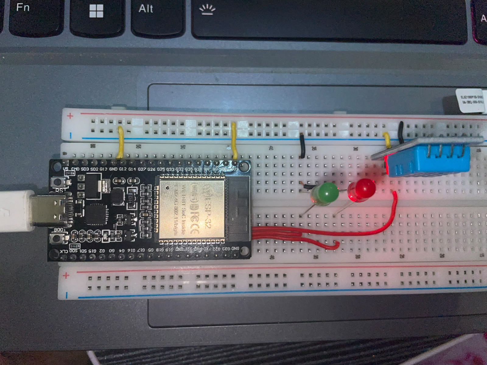
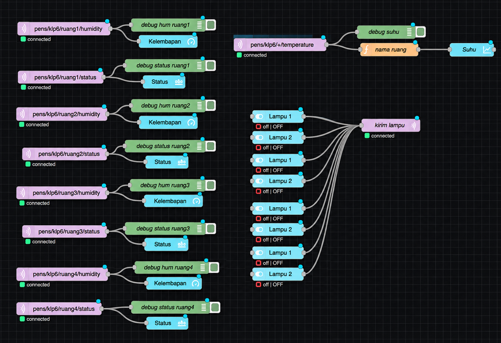
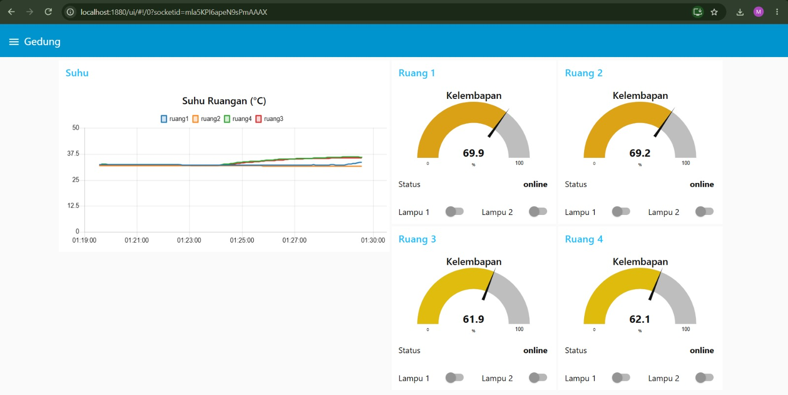
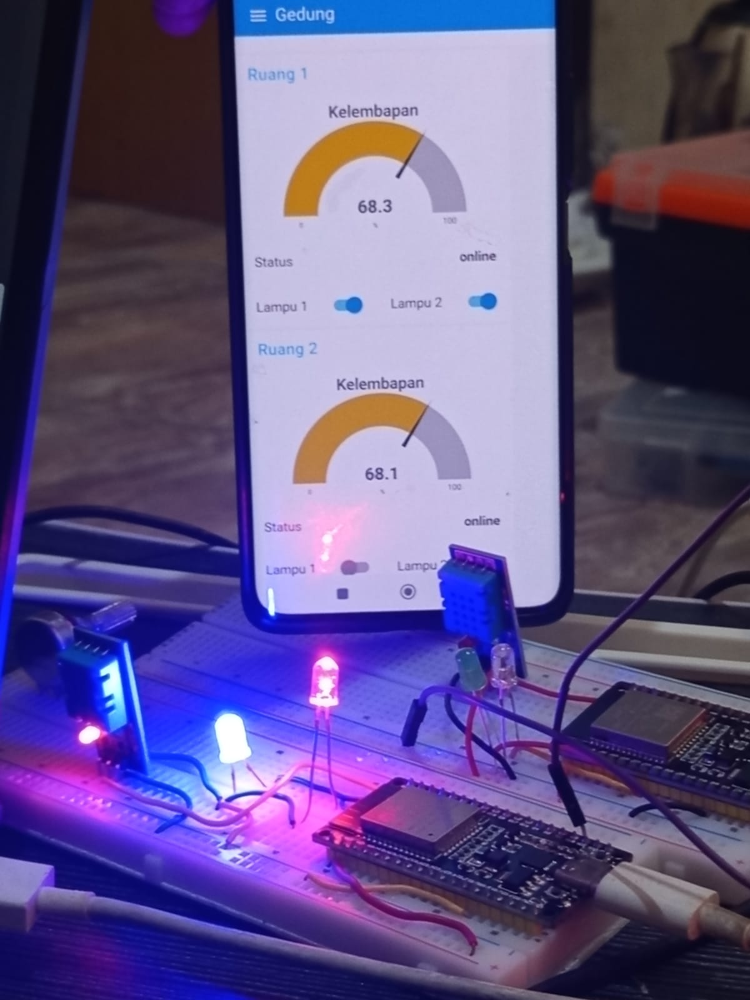

# Sistem Monitoring dan Kontrol Ruangan Berbasis ESP32 dan Node-RED

**Kelompok:** 6

**Video Presentasi:** [Masukkan link video presentasi]
**Video Demo:** [Masukkan link video demo]

---

## 1. Deskripsi Singkat Sistem

Proyek ini merupakan sistem monitoring suhu dan kelembapan empat ruangan menggunakan ESP32 dan sensor DHT11 dengan komunikasi MQTT. Data sensor dikirimkan ke MQTT Broker dan ditampilkan melalui dashboard Node-RED secara real-time. Selain monitoring, sistem juga memungkinkan pengguna mengontrol dua lampu pada setiap ruangan melalui dashboard Node-RED.

## 2. Anggota Kelompok

|No.|        Nama           |     NRP    | Ruangan |
|---|-----------------------|------------|---------|
| 1 | M. Nizam Zamzami      | 2124600063 | Ruang 1 |
| 2 | Galang Fermandhika Y  | 2124600067 | Ruang 2 |
| 3 | Paskalis Pandu P      | 2124600068 | Ruang 3 |
| 4 | Arnold Immanuel P     | 2124600083 | Ruang 4 |

## 3. Link Video

- **Video presentasi:** [Masukkan link]
- **Video demo:** [Masukkan link]

## 4. Arsitektur Sistem

Sistem menggunakan empat ESP32 yang berkomunikasi dengan Node-RED melalui satu MQTT Broker. Setiap ESP32 membaca data suhu dan kelembapan serta menerima perintah untuk mengontrol lampu.

### Diagram Arsitektur

```text
+-------------+     +-------------+
| ESP32       |     | ESP32       |
| Ruang 1     |     | Ruang 2     |
+------+------+     +------+------+
       |                   |
       +---------+---------+
                 |
       +---------+---------+
       |                   |
+------+------+     +------+------+
| ESP32       |     | ESP32       |
| Ruang 3     |     | Ruang 4     |
+------+------+     +------+------+
       |                   |
       +---------+---------+
                 |
                 v
          +-------------+
          | MQTT Broker |
          +------+------+
                 |
                 v
          +-------------+
          |  Node-RED   |
          +------+------+
                 |
                 v
          +-------------+
          |  Dashboard  |
          +-------------+
```

## 5. Perangkat Keras

### Daftar Komponen

|No.|    Komponen      |     Jumlah       |
|---|------------------|------------------|
| 1 | ESP32            | 4 buah           |
| 2 | Sensor DHT11     | 4 buah           |
| 3 | LED              | 8 buah           |
| 4 | Resistor 220 Ohm | 8 buah           |
| 5 | Breadboard       | Sesuai kebutuhan |
| 6 | Kabel jumper     | Secukupnya       |

### Konfigurasi Pin ESP32

Berikut konfigurasi pin untuk program ESP32 Ruang 1, 2, dan 3.

| Komponen    | Pin ESP32 |
|-------------|-----------|
| DHT11 VCC   |    3.3V   |
| DHT11 GND   |     GND   |
| DHT11 DATA  |    GPIO 4 |
| LED Lampu 1 |   GPIO 18 |
| LED Lampu 2 |   GPIO 19 |


Berikut konfigurasi pin untuk program ESP32 Ruang 4.

| Komponen    | Pin ESP32 |
|-------------|-----------|
| DHT11 VCC   |    3.3V   |
| DHT11 GND   |     GND   |
| DHT11 DATA  |    GPIO 4 |
| LED Lampu 1 |   GPIO 32 |
| LED Lampu 2 |   GPIO 33 |


### Foto Rangkaian



## 6. Konfigurasi MQTT Topic dan Broker

### Konfigurasi Broker

|  Parameter   |       Nilai       |
|--------------|-------------------|
|    Broker    | MQTT Broker lokal |
|  IP Address  | 192.168.100.40    |
|     Port     | 1883              |
|   Kelompok   | klp6              |
|    Prefix    | pens/klp6         |

### Tabel MQTT Topic Final

|          MQTT Topic            | Arah             |     Payload      | QoS |Retain|
|--------------------------------|------------------|------------------|-----|------|
| `pens/klp6/ruangN/temperature` | ESP32 → Node-RED | Suhu (°C)        |  0  | Tidak|
| `pens/klp6/ruangN/humidity`    | ESP32 → Node-RED | Kelembapan (%)   |  0  | Tidak|
| `pens/klp6/ruangN/lamp1`       | Node-RED → ESP32 | 1 / 0            |  1  | Tidak|
| `pens/klp6/ruangN/lamp2`       | Node-RED → ESP32 | 1 / 0            |  1  | Tidak|
| `pens/klp6/ruangN/status`      | ESP32 / LWT      | online / offline |  0  |   Ya |

Keterangan:
- `ruangN` merupakan identitas ruangan, yaitu ruang1, ruang2, ruang3, atau ruang4.
- Payload `1` digunakan untuk menyalakan lampu.
- Payload `0` digunakan untuk mematikan lampu.
- Status `online` dan `offline` digunakan untuk menunjukkan kondisi koneksi ESP32.

## 7. Cara Menjalankan Sistem

### Library Arduino yang Dibutuhkan

1. EspMQTTClient oleh Patrick Lapointe.
2. DHT sensor library oleh Adafruit.
3. Adafruit Unified Sensor (jika diperlukan).

### Langkah Upload Program ESP32

1. Buka file program ESP32 melalui Arduino IDE.
2. Instal seluruh library yang dibutuhkan.
3. Hubungkan ESP32 ke komputer.
4. Pilih board dan port ESP32 yang digunakan.
5. Sesuaikan konstanta `ROOM` dengan ruangan masing-masing ESP32.
6. Sesuaikan `WIFI_SSID` dan `WIFI_PASS` dengan jaringan Wi-Fi yang digunakan.
7. Pastikan alamat `BROKER` sesuai dengan MQTT Broker.
8. Upload program ke ESP32.
9. Buka Serial Monitor dengan baud rate 115200 untuk memeriksa koneksi.

### Langkah Import Flow Node-RED

1. Jalankan Node-RED.
2. Buka `http://localhost:1880`.
3. Buka menu Manage Palette.
4. Instal paket `node-red-dashboard`.
5. Pilih menu Import.
6. Import file `flows.json`.
7. Pastikan konfigurasi MQTT Broker sudah sesuai.
8. Klik Deploy untuk menjalankan flow.

### Alamat Dashboard

Dashboard dapat diakses melalui:

`http://localhost:1880/ui`

Untuk mengakses melalui HP pada jaringan yang sama:

`http://IP_LAPTOP:1880/ui`

## 8. Screenshot Flow Node-RED dan Dashboard

### Flow Node-RED



### Dashboard Node-RED



## 9. Hasil Pengujian T1–T12

|No. |    Pengujian        | Hasil |                                 Keterangan                               |
|----|---------------------|-------|--------------------------------------------------------------------------|
| T1 | Koneksi MQTT        |   ✓  | Seluruh ESP32 berhasil terhubung ke MQTT Broker.                          |
| T2 | Data 4 ruang        |   ✓  | Data suhu dan kelembapan dari empat ruangan berhasil diterima.            |
| T3 | Chart suhu          |   ✓  | Grafik menampilkan data suhu dari empat ruangan.                          |
| T4 | Sensor berubah      |   ✓  | Perubahan pembacaan sensor berhasil ditampilkan pada dashboard.           |
| T5 | Lampu tepat sasaran |   ✓  | Perintah lampu hanya memengaruhi ruangan yang dituju.                     |
| T6 | Mematikan lampu     |   ✓  | Lampu berhasil dimatikan melalui dashboard.                               |
| T7 | Payload salah       |   ✓  | Payload selain 1 dan 0 diabaikan oleh ESP32.                              |
| T8 | Status online       |   ✓  | Seluruh perangkat menampilkan status online.                              |
| T9 | Last Will Testament |   ✓  | Status berubah menjadi offline ketika ESP32 terputus secara tidak normal. |
| T10 | Retained message   |   ✓  | Status terakhir tetap tersedia setelah Node-RED dijalankan kembali.       |
| T11 | Reconnect          |   ✓  | ESP32 berhasil terhubung kembali setelah koneksi terputus.                |
| T12 | Akses dari HP      |   ✓  | Dashboard berhasil diakses melalui HP pada jaringan yang sama.            |

### Dokumentasi Pengujian



## 10. Ruangan yang Disimulasikan
Tidak ada ruang yang disimulasikan, karena jumlah ruangan adalah 4, dan semua ruang memakai ESP32 sungguhan

## 11. Kendala dan Solusi

|No.|                  Kendala                  |                          Solusi                             |
|---|-------------------------------------------|-------------------------------------------------------------|
| 1 | ESP32 sulit terhubung ke Wi-Fi.           | Memeriksa SSID dan password Wi-Fi.                          |
| 2 | Sensor DHT11 gagal membaca data.          | Memeriksa wiring dan pin sensor.                            |
| 3 | Data tidak muncul di dashboard.           | Memeriksa MQTT Topic dan koneksi broker.                    |
| 4 | Lampu tidak merespons perintah.           | Memeriksa topic, payload, dan pin GPIO.                     |
| 5 | Status perangkat tidak diperbarui.        | Memeriksa konfigurasi MQTT Last Will dan Retain.            |
| 6 | Dashboard tidak dapat diakses melalui HP. | Memastikan HP dan komputer terhubung ke jaringan yang sama. |

## 12. Pembagian Tugas Anggota

|No.|        Nama           |                 Pembagian tugas                       | 
|---|-----------------------|-------------------------------------------------------|
| 1 | M. Nizam Zamzami      | Hardware dan program ruangan 1, konfigurasi nodered   | 
| 2 | Galang Fermandhika Y  | Hardware dan software ruang 2, membuat video          | 
| 3 | Paskalis Pandu P      | Hardware dan software ruang 3, membuat file Readme.md | 
| 4 | Arnold Immanuel P     | Hardware dan software ruang 4, Membuat PPT            | 